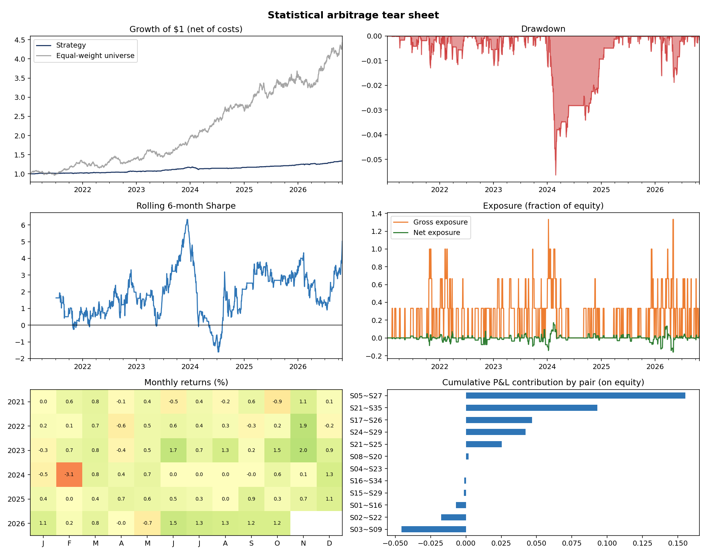

# Statistical Arbitrage Engine: Market-Neutral Pairs Trading


A research engine of the kind a systematic equity market-neutral desk uses: it **finds cointegrated pairs, trades the spread
long/short with dollar-neutral legs, re-selects pairs walk-forward, charges realistic costs (commissions + short-borrow), and reports
like a hedge fund** (alpha/beta decomposition, market neutrality, drawdown, exposure, tear sheet).

It also includes the thing most student projects lack: a **control experiment**. Run it on data with *no* real relationships and it
shows you that the "edge" disappears. That is the difference between research and curve-fitting.



## Pipeline
1. **Screen** every stock pair on a trailing formation window: return-correlation filter → **Engle-Granger cointegration test** (own fast implementation, verified against `statsmodels.coint` to 1e-8) → hedge ratio β → **Ornstein-Uhlenbeck half-life** filter (3 to 40 days) → one pair per stock.
2. **Signal:** rolling z-score of the spread `ln(y) - β ln(x) - α`; enter at |z|>2, exit at |z|<0.5, **stop-loss** at |z|>4, **time-stop** after ~3 half-lives, lock-out after forced exits, never open beyond the stop.
3. **Execute:** next-bar trading (no look-ahead), dollar-neutral legs (`w_y = 1/(1+β)`, `w_x = β/(1+β)`), per-pair capital slots, forced close at each re-selection.
4. **Costs:** 5 bps per unit traded notional and 50 bps annualised borrow on the short leg (both configurable).
5. **Walk-forward:** select on 252 days, trade the next 63 unseen days, roll forward.
6. **Report:** Sharpe/Sortino/Calmar, CVaR, skew/kurtosis, **CAPM alpha with t-stat, beta, R²**, exposure, trade statistics, per-pair P&L, tear sheet.

## Run
```bash
pip install -r requirements.txt
python -m statarb --demo                  # synthetic universe with planted pairs (ground truth known)
python -m statarb --null                  # CONTROL: universe with no cointegration, expect no edge
python -m statarb --tickers KO PEP XOM CVX JPM BAC WFC C ...   # live data (same-sector names work best)
python -m pytest -q                       # 11 tests
```
Useful flags: `--formation 252 --trade 63 --max-pairs 6 --entry 2 --exit 0.5 --stop 4 --cost-bps 5 --borrow-bps 50 --leverage 2`

## What the demo shows (synthetic data: read the caveat)
| Run | Sharpe | Alpha (ann.) | Alpha t-stat | Beta | Trade win rate |
|---|---:|---:|---:|---:|---:|
| Planted pairs (6 true pairs, 2 with structural breaks) | 1.84 | 4.9% | 4.5 | -0.001 | 82% |
| **Null control (no true pairs)** | -0.55 | -1.1% | -1.4 | 0.002 | 50% |

- **Market neutrality works:** beta ≈ 0 and R² ≈ 0 against the equal-weight universe.
- **Discovery works but is imperfect:** ~87% of selected pairs were genuine; the rest are multiple-testing false positives, and they are the pairs that lose money.
- **The structural-break pairs hurt**: cointegration can vanish mid-sample, and the stop-loss/time-stop and re-selection are what contain the damage.

> **Caveat (important, and say it in interviews).** The demo data has mean reversion *planted* by construction, so a good Sharpe is expected. It validates the machinery, not the strategy.
> On real equities, pairs trading is crowded and its edge has decayed substantially; expect far lower returns, more false positives, and regime risk. Run `--tickers` on live data and report what you actually find.

## Design choices worth discussing
- **Multiple testing:** 40 stocks = 780 pairs; at p<0.05 you would "find" ~39 spurious pairs. Hence the strict p<0.01 threshold, an economically-sensible β and half-life filter, and *out-of-sample* evaluation.
- **Walk-forward re-selection** rather than one static pair list, because relationships drift.
- **Low average gross exposure** (~0.2x in the demo) is realistic: positions are only open when spreads are stretched. A fund would lever this up and diversify across more pairs/sectors; the Sharpe, not the CAGR, is the quality measure.
- **Same-sector universes** are preferred on live data (`sectors=` argument) to improve economic plausibility of a cointegrating relationship.

## Limitations
Daily closes only (no intraday/queue modelling), no market impact or capacity model, constant borrow cost with no hard-to-borrow names, no corporate-action edge cases, in-sample-selected thresholds (entry/exit/stop were not tuned here, so none of the reported numbers is optimised).

## Roadmap
Kalman-filter dynamic hedge ratios · Johansen test for baskets · sector/beta-neutral portfolio optimisation · volatility-targeted sizing · intraday execution · regime filter · deflated Sharpe ratio for multiple-testing-adjusted performance

```
statarb/  data.py  pairs.py  signals.py  backtest.py  analytics.py  cli.py
tests/    cointegration vs statsmodels, half-life, signal state machine, no look-ahead, costs, null experiment
```
MIT License. Educational use only; not investment advice.

## Author

**Dhruv Singh**

GitHub: [@Dhruv1176](https://github.com/Dhruv1176)
